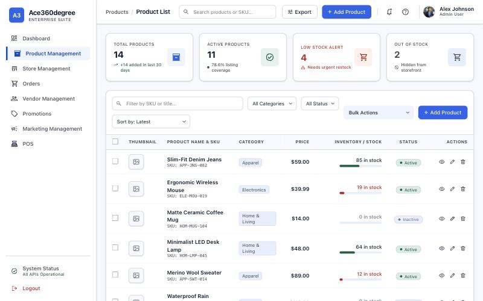
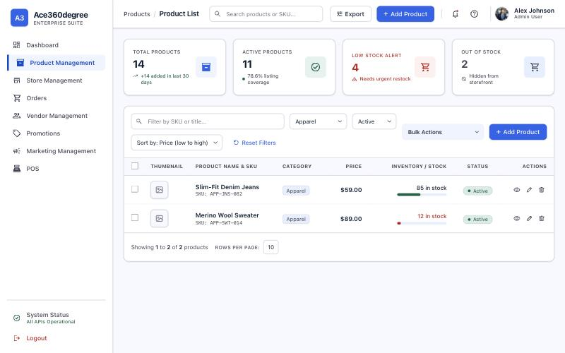
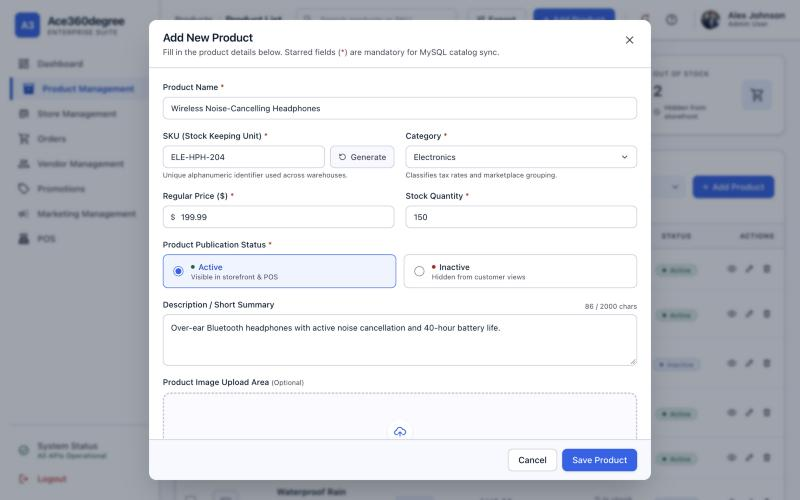
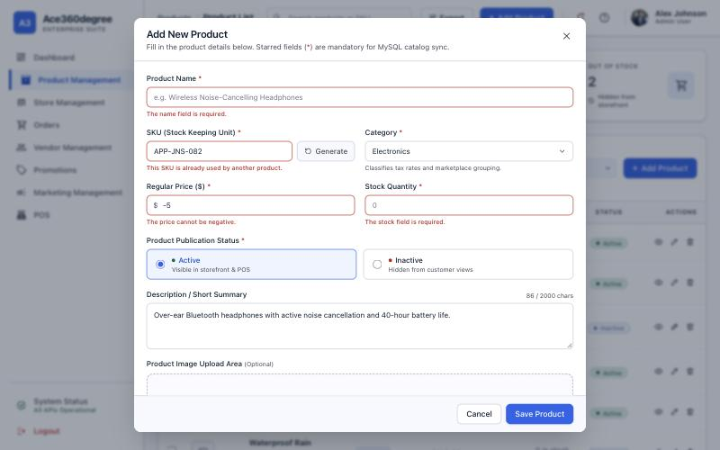
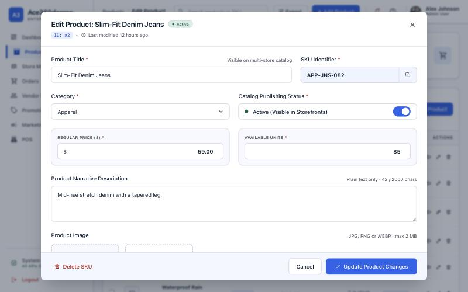
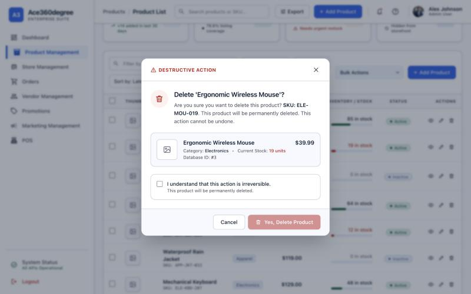
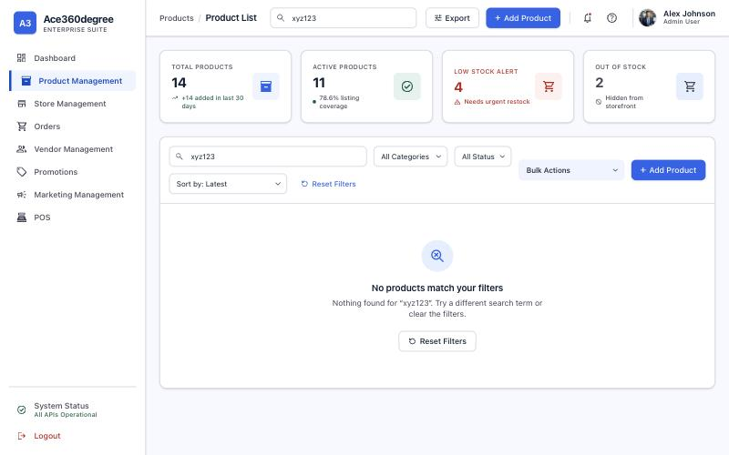
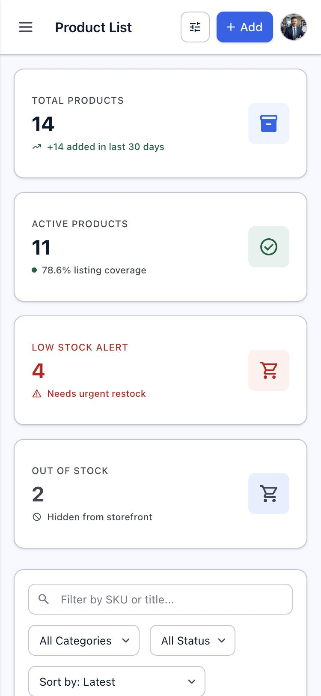

# Ace360degree – Product Admin Dashboard

A product management admin area built with **Laravel, Blade and MySQL** for the Ace360degree internship assignment.
It supports full product CRUD, search, combined filters, sorting and server-side pagination, styled after the supplied Figma dashboard.

---

## Features

**Admin layout**
- Sidebar with **Dashboard** and **Product Management** (other menu items are placeholders)
- Top header with page title, breadcrumb, product search and admin avatar placeholder
- Responsive: the sidebar becomes a slide-in menu (hamburger) on small screens and the table scrolls horizontally

**Product list** (`/products`)
- Four stat cards from the database: total, active, low stock (1–20 units), out of stock
- Table columns: thumbnail, name & SKU, category, price, stock (with stock bar), status, actions
- Toolbar: search, category filter, status filter, sorting and **Reset Filters**
- Search, filters and sort **combine**, and are kept in the URL
- Server-side pagination that **keeps the query string**, "Showing X to Y of Z products", rows per page (5 / 10 / 25 / 50)
- Empty state (different message for "no products" and "no products match your filters")

**Create / Edit / View / Delete**
- Add and Edit forms in a modal (same form partial for both), with image upload (drag & drop or browse) and preview
- Server-side validation with error messages under each field; the modal reopens with the old input after a validation error
- Product details page (eye icon)
- Delete confirmation modal: the delete button stays disabled until "I understand…" is ticked
- Success flash message (toast) after create, update and delete
- After saving or deleting you return to the same filtered page

**Extra**
- Export the current filtered list as CSV

---

## Tech stack

| Part | Used |
|---|---|
| Backend | Laravel 13 (PHP 8.4) |
| Database | MySQL |
| Views | Blade templates and components |
| Styling | Tailwind CSS 4 (via Vite) |
| Small interactions | Alpine.js (modals, image preview, mobile menu, toast) |

---

## Requirements

- PHP **8.3 or 8.4** with the `pdo_mysql`, `mbstring`, `fileinfo` and `gd` extensions
- Composer 2
- MySQL 8 (or compatible)
- Node.js **20.19+ or 22.12+** and npm

> Note: the project was developed on PHP 8.4. A very new PHP 8.6 build showed an intermittent `zend_mm_heap corrupted` crash during development, so PHP 8.4 is recommended. Composer's platform PHP is pinned to 8.4 in `composer.json`.

---

## Setup (from a fresh clone)

```bash
# 1. Get the code
git clone <repository-url> ace360degree
cd ace360degree

# 2. Install PHP and JavaScript dependencies
composer install
npm install

# 3. Create your environment file and app key
cp .env.example .env
php artisan key:generate

# 4. Create the MySQL database
mysql -u root -e "CREATE DATABASE ace360degree CHARACTER SET utf8mb4 COLLATE utf8mb4_unicode_ci;"

# 5. Create the tables and add the sample products
php artisan migrate --seed

# 6. Make uploaded images publicly visible
php artisan storage:link

# 7. Build the CSS/JS
npm run build

# 8. Start the app
php artisan serve
```

Open **http://127.0.0.1:8000/products**

For development, run `npm run dev` in a second terminal instead of `npm run build`, so style changes appear immediately.

To reset the database to the sample data at any time:

```bash
php artisan migrate:fresh --seed
```

### `.env` settings

`.env` is **not committed** (it is listed in `.gitignore`). Copy `.env.example` and adjust the database values for your machine:

| Key | Example | Meaning |
|---|---|---|
| `APP_KEY` | *(generated)* | Created by `php artisan key:generate`. Keep it secret. |
| `APP_URL` | `http://localhost:8000` | Address of the app |
| `DB_CONNECTION` | `mysql` | Database driver |
| `DB_HOST` / `DB_PORT` | `127.0.0.1` / `3306` | MySQL server |
| `DB_DATABASE` | `ace360degree` | Database name |
| `DB_USERNAME` / `DB_PASSWORD` | `root` / *(empty)* | Your local MySQL login |
| `FILESYSTEM_DISK` | `public` | Uploaded images go to `storage/app/public` |

No passwords, API keys or other secrets are committed to the repository.

---

## Database

Table `products` (migration: `database/migrations/*_create_products_table.php`)

| Column | Type | Rules |
|---|---|---|
| `id` | bigint, auto increment | primary key |
| `name` | string | required |
| `sku` | string(64) | required, **unique** (database index + validation) |
| `description` | text | nullable |
| `price` | decimal(10,2) | required, `>= 0` (validation + MySQL `CHECK` constraint) |
| `category` | string | required, one of: Apparel, Electronics, Home & Living, Accessories |
| `stock_quantity` | unsigned integer | required, `>= 0` |
| `status` | enum `active` / `inactive` | required |
| `image_path` | string | nullable |
| `created_at` / `updated_at` | timestamps | |

`database/seeders/ProductSeeder.php` adds **15 sample products** (the first five match the Figma design).

---

## How it works

### Routes – `routes/web.php`

```php
Route::get('products/export', [ProductController::class, 'export'])->name('products.export');
Route::resource('products', ProductController::class);
```

`Route::resource` creates the seven named CRUD routes:

| Method | URL | Name | Controller method |
|---|---|---|---|
| GET | `/products` | `products.index` | `index` – list with filters |
| GET | `/products/create` | `products.create` | `create` – list with the Add modal open |
| POST | `/products` | `products.store` | `store` – save a new product |
| GET | `/products/{product}` | `products.show` | `show` – details page |
| GET | `/products/{product}/edit` | `products.edit` | `edit` – list with the Edit modal open |
| PUT | `/products/{product}` | `products.update` | `update` – save changes |
| DELETE | `/products/{product}` | `products.destroy` | `destroy` – delete |

The export route is registered **before** the resource, otherwise `/products/export` would be treated as `/products/{product}`.
`{product}` uses **route model binding**: Laravel loads the `Product` with that id automatically and returns a 404 page if it does not exist.

### Controller – `app/Http/Controllers/ProductController.php`

- `index()` reads the filters from the URL, builds one query and paginates it.
- `store()` / `update()` receive an already validated `ProductRequest`, save the image with `store('products', 'public')` and redirect back to the same filtered list with a flash message.
- `update()` deletes the old image file only after the database update succeeded.
- `destroy()` deletes the row and its image file. If the deleted product was the only one on the last page, it redirects to the new last page instead of an empty page.
- Filter values are checked against allowed lists (categories, statuses, sort options), so a hand-edited URL cannot break the query.

### Eloquent queries – `app/Models/Product.php`

The list query is built from small **query scopes**. Each scope only adds a `WHERE` when its value is filled in, so they chain and combine with `AND`:

```php
Product::query()
    ->search($search)            // (name LIKE %term% OR sku LIKE %term%)
    ->filterCategory($category)  // AND category = ?
    ->filterStatus($status)      // AND status = ?
    ->sortBy($sort);             // ORDER BY <allowed column>, id
```

- The search wraps the `OR` in brackets (a closure) so it combines correctly with the filters.
- `%` and `_` typed by the user are escaped, so they are searched literally.
- Sorting only uses columns from a fixed list (`Product::SORTS`), never raw user input.
- `$fillable` lists the columns that may be mass-assigned; `casts()` returns `price` with 2 decimals and `stock_quantity` as an integer.
- The four stat cards are calculated by MySQL in **one** query.

### Validation – `app/Http/Requests/ProductRequest.php`

A Form Request used by both `store()` and `update()`. Laravel runs it before the controller; if a rule fails, the user is sent back with the errors and their old input.

| Field | Rules |
|---|---|
| `name` | required, string, max 255 |
| `sku` | required, letters/numbers/`-`/`_`, max 64, **unique** – `Rule::unique('products', 'sku')->ignore($product)` so a product can keep its own SKU when edited |
| `price` | required, numeric, max 2 decimals, `min:0` |
| `stock_quantity` | required, integer, `min:0` |
| `category` / `status` | required, must be one of the allowed values |
| `description` | nullable, max 2000 characters |
| `image` | nullable, jpg/png/webp, max 2 MB |

The SKU is trimmed and upper-cased first, so `app-tsh-001` counts as a duplicate of `APP-TSH-001`.

### Pagination

```php
$products = $query->paginate($perPage)->withQueryString();
```

- `paginate()` runs `LIMIT/OFFSET` plus a `COUNT(*)` in MySQL (server-side).
- `withQueryString()` adds the current `?search=…&category=…&status=…&sort=…` to every page link, so filters stay active on page 2, 3, …
- The view uses `firstItem()`, `lastItem()` and `total()` for "Showing X to Y of Z products", and a custom pagination view (`resources/views/partials/pagination.blade.php`).
- Changing a filter submits the form without a `page` value, so it goes back to page 1. **Reset Filters** is a plain link to `/products` with no query string.

### Security

- `@csrf` on every form; `@method('PUT')` and `@method('DELETE')` for update and delete
- All output uses escaped Blade `{{ }}` – there is no `{!! !!}` in the views; descriptions are plain text
- Mass assignment protection with `$fillable`; only validated data is saved (`$request->safe()`)
- Uploaded files are validated by type and size and stored with random file names
- CSV export guards against formula injection (cells starting with `=`, `+`, `-`, `@`)

---

## Project structure (main files)

```
app/
  Http/Controllers/ProductController.php   CRUD, filters, pagination, export
  Http/Requests/ProductRequest.php         validation rules
  Models/Product.php                       fillable, casts, query scopes, helpers
  Support/ProductListQuery.php             keeps the list's filters in links
database/
  migrations/*_create_products_table.php
  seeders/ProductSeeder.php                15 sample products
resources/
  views/layouts/app.blade.php              page layout
  views/partials/                          sidebar, header, toast, pagination
  views/products/index.blade.php           product list page
  views/products/show.blade.php            product details page
  views/products/partials/                 stats, toolbar, table, empty state, form modal, delete modal
  views/components/                        icon, status pill, delete button
  js/app.js                                Alpine.js components
routes/web.php
```

---

## Screenshots

### Product list


### Search + filters combined (Apparel, Active, sorted by price) with Reset Filters


### Add Product modal


### Validation errors (empty name, duplicate SKU, negative price, missing stock)


### Edit Product modal


### Delete confirmation (button disabled until the checkbox is ticked)


### Empty state


### Mobile view


---

## Manual test checklist

- [ ] `php artisan migrate:fresh --seed` works and shows 15 products
- [ ] Search by part of a name (`shirt`) and part of a SKU (`ELE`)
- [ ] Category + status + search together
- [ ] Go to page 2 with filters on – filters stay in the URL
- [ ] Reset Filters clears everything
- [ ] Search for `xyz123` – empty state appears
- [ ] Add a product – it appears in the list with a success message
- [ ] Add with an existing SKU (`APP-TSH-001`) – "already used" error, modal stays open
- [ ] Add with a negative price or stock – rejected
- [ ] Edit a product without changing its SKU – saves without error
- [ ] Upload, change and remove an image
- [ ] Delete – button disabled until the checkbox is ticked; product removed with a success message
- [ ] Narrow browser window – hamburger menu and horizontally scrolling table

---

## Known limitations

- **No login or roles.** The admin name/avatar, Logout and the other sidebar items (Store Management, Orders, …) are placeholders.
- **Bulk actions, notifications and help** buttons are placeholders; the row checkboxes only highlight rows.
- **One image per product** (no gallery or variants).
- **Categories are a fixed list** in `Product::CATEGORIES`, not a separate table.
- Sale price, low-stock threshold per product and the "Draft" status from the design were left out because they are not in the assignment's database fields. The low-stock limit is a fixed 20 units.
- The **seeded products have no images**; images can be added through Edit.
- After a validation error the chosen image file must be selected again (browsers do not allow re-filling file inputs).
- The header search box searches products but resets the toolbar's category/status filters.
- No automated feature tests yet; testing was done manually with the checklist above.
- The bottom dashboard panels from the Figma design (stock replenishment, SKU breakdown, channel sync) were not built.
